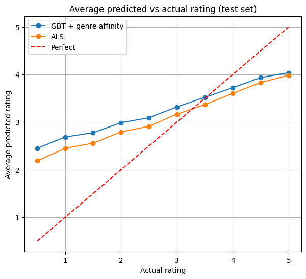

# Hybrid Movie Recommender: MovieLens 25M + IMDb + TMDB

A PySpark pipeline on Databricks that predicts user movie ratings and ranks movies. It compares simple baselines, ALS collaborative filtering, and a hybrid gradient-boosted-trees (GBT) model that adds IMDb/TMDB metadata and a user-genre affinity feature. Every model is scored on a held-out test set, and all features are built from training data only.

## Results

Evaluated on 504,298 held-out ratings (10% user sample, 80/20 split).

| Model | RMSE | MAE | NDCG@10 | Precision@10 |
|---|---|---|---|---|
| Global mean | 1.061 | 0.841 | – | – |
| Popularity | – | – | 0.858 | 0.633 |
| User + movie bias | 0.861 | 0.657 | 0.887 | 0.697 |
| GBT, averages only | 0.869 | 0.662 | – | – |
| GBT, + IMDb/TMDB metadata | 0.867 | 0.660 | – | – |
| GBT, + metadata + genre affinity | 0.850 | 0.648 | 0.895 | 0.705 |
| **ALS (rank 20, untuned)** | **0.812** | **0.628** | **0.916** | **0.739** |

**Key findings**
- IMDb/TMDB metadata improved RMSE by only ~0.2% once user and movie averages were known.
- A leakage-safe user-genre affinity feature gave a ~2% gain, roughly nine times larger: knowing what a user likes mattered far more than external ratings.
- The best hybrid beat the bias baseline but not ALS, which was ~4.5% better on rating error and led on both ranking metrics.
- Ranking by how well liked a movie is (bias model) beat ranking by how often it was rated (popularity).

Both models over-predict low ratings and under-predict high ones (regression toward the middle); ALS is slightly tighter and closer to the diagonal.

## Data

| Source | Used for |
|---|---|
| [MovieLens 25M](https://grouplens.org/datasets/movielens/25m/) | 25,000,095 ratings from 162,541 users on 59,047 movies (about 99.7% of the user-movie matrix is empty) |
| [IMDb non-commercial datasets](https://developer.imdb.com/non-commercial-datasets/) | Movie rating and vote count |
| [TMDB API](https://developer.themoviedb.org/docs) | Vote average, vote count, popularity |

MovieLens `links.csv` maps `movieId` to IMDb and TMDB IDs for joining. The data files are not included in this repository.

## Method

1. **Frozen split:** sample 10% of users, split their ratings 80/20, and save both as tables so the test set never changes between runs.
2. **Baselines:** global mean; global mean plus shrunk user and movie offsets; popularity (for ranking).
3. **ALS:** Spark ALS, rank 20, regularization 0.1. Users or movies unseen in training are dropped (99.5% of test rows scored), so the bias baseline is rescored on the same rows for a fair comparison.
4. **Leakage-safe features:** user and movie averages and counts come from training data only. For training rows, each row's own rating is removed from its features (leave-one-out), and averages are shrunk toward the global mean.
5. **Hybrid GBT:** 50 trees, depth 5, on user/movie averages, IMDb/TMDB features (with missing-value flags), and the genre-affinity feature.
6. **Genre affinity:** how far a user's average rating in a movie's genres sits from their overall average, built with the same leave-one-out and shrinkage rules.
7. **Ranking evaluation:** for each user with at least 10 test ratings, rank their held-out movies by model score and compute NDCG@10 and Precision@10 (rating at least 4.0 counts as relevant).

**Metrics:** RMSE penalizes large errors; MAE is the average miss in stars; NDCG@10 rewards placing higher-rated movies near the top; Precision@10 is the share of the top 10 the user rated 4.0 or higher.

## Limitations

- 10% user sample and a random (not time-based) split; a time-based split would be more realistic.
- ALS is untuned.
- Ranking re-ranks each user's held-out rated items, not the full catalog, so absolute NDCG is not comparable to full-catalog results.
- IMDb/TMDB scores reflect current opinion, not opinion at the time of each rating.
- GBT scores can shift in the third decimal between runs (distributed training is not fully deterministic).

## Running it

The notebook (`notebooks/recommender_pipeline.ipynb`) was developed on Databricks. It expects three tables in `workspace.default`: `ratings_clean`, `movies_clean`, and `unified_movie_metadata_final_clean`. The data preparation that built them (cleaning MovieLens, joining IMDb and TMDB metadata through `links.csv`) was done in a separate notebook that is not included in this repository.

## Next steps

Time-based split, ALS hyperparameter tuning, a full 25M-rating run, and evaluating ranking over the full catalog.

## Author

Yola Charara · yolacharara@gmail.com
